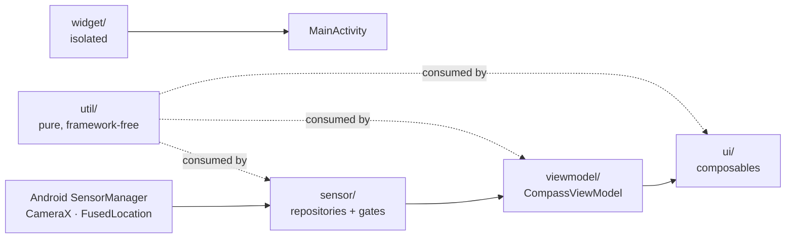

# Architecture Spine — minimal-compass

Fixes only what two independently-built parts could otherwise choose
incompatibly. It does not restate `CLAUDE.md`, which documents what the code
*does*; this states what future code *must* do.

Every rule below is written to be judged objectively. Where a rule needed a
mechanical test to be enforceable, it has one.

## Design Paradigm

**Layered unidirectional dataflow.** One direction, no back-edges:



| Layer | Owns | May not |
| --- | --- | --- |
| `sensor/` | Hardware access, raw derivation, decision gates | Know about Compose |
| `viewmodel/` | All state, all policy, all persistence | Draw |
| `ui/` | Rendering and presentation state | Touch hardware or persist, except the exceptions named in AD-1 |
| `util/` | Pure functions | Import Android framework types, except `PermissionAskLog` and `MotionUtil` |
| `widget/` | The launcher tile | Share any runtime state with the app (AD-9) |

## Invariants & Rules

### AD-1 — One source of truth for every sensor-derived value [ADOPTED]

- **Binds:** every value derived from a sensor
- **Prevents:** a second heading or tilt appearing beside `CompassViewModel` and drifting from it
- **Rule:** hardware is read only in `sensor/`, exposed as a `Flow`, collected only by `CompassViewModel`, published only as `StateFlow`. Composables obtain app state exclusively via `collectAsStateWithLifecycle()`.
- **Named exceptions, exhaustive.** Composables may additionally: observe `cam.cameraInfo.torchState` (CameraX exposes no Flow), call `util/PermissionAskLog` (the marker must be written at the instant of the request), and read `Settings.Global.ANIMATOR_DURATION_SCALE` via `rememberReduceMotion()`. Adding a fourth requires amending this AD.

### AD-2 — Sensors follow the UI, never the ViewModel's scope [ADOPTED]

- **Binds:** every hardware subscription
- **Prevents:** sensors held while backgrounded
- **Rule:** share with `stateIn` + `SharingStarted.WhileSubscribed`; the UI drives collection from `repeatOnLifecycle(STARTED)`. Never collect the sensor flow on `viewModelScope` directly.

### AD-3a — Threshold logic is a class in `sensor/`, never an effect in a composable

- **Binds:** any hysteresis, dwell, dead zone, deadband or debounce
- **Prevents:** the same shape written differently in four layers, and timing logic that cannot be unit-tested
- **Rule:** it is a framework-free, deterministic class in `sensor/`, unit-tested, consumed by the ViewModel. Not a `LaunchedEffect`. These classes are stateful across emissions by design — "deterministic", not "pure".

### AD-3b — A gate that measures time takes an injected clock

- **Binds:** gates whose decision depends on elapsed time
- **Prevents:** logic that can only be tested by waiting
- **Rule:** take `nowMs: () -> Long`; production passes `SystemClock::elapsedRealtime`, tests pass a counter. A gate that does not measure time takes no clock — `LevelPostureGate` is correct as written.

### AD-4 — Hardware-affecting state lives in the ViewModel

- **Binds:** any state deciding when a sensor or the camera is open
- **Prevents:** hardware lifecycle decided in two places
- **Rule:** composables hold presentation state only — a fade alpha, a remembered page. **Overlap with AD-3a is resolved in favour of both:** the decision is a gate class in `sensor/`, its output is published as ViewModel `StateFlow`, the composable only reads it.

### AD-5 — Position is never persisted or transmitted [ADOPTED]

- **Binds:** anything touching location
- **Prevents:** a location history in preferences, and a false Play Data Safety declaration
- **Rule:** `DeclinationRepository` returns only the derived angle; the `Location` never leaves the function. Preferences hold `last_declination_deg` and a timestamp, never coordinates.

### AD-6 — Every analytics parameter is low-cardinality

- **Binds:** every `Telemetry` call
- **Prevents:** a sensor stream or a location becoming an analytics dimension
- **Rule:** an enum name, a boolean, or a bucketed integer. Never a raw sensor value, coordinate, or free text. Session durations (`total_sec`, `sec_to_stable`) are the existing bounded-integer cases and are permitted; a new unbounded number must be bucketed.

### AD-7 — Cyclic and non-cyclic values use different maths [ADOPTED]

- **Binds:** every filter, animation target, deadband and blend
- **Prevents:** a naive average of 1° and 359° yielding 180° — exactly backwards
- **Rule:** bearings go through `shortestArcDelta`. `adaptiveLowPass` is for non-cyclic values only and must never be pointed at a bearing.

### AD-8 — A state distinguished by colour is distinguished by something else too

- **Binds:** every UI element in every palette
- **Prevents:** two red marks pointing different ways, and states invisible to a colour-blind user
- **Rule:** red is north and nothing else; `levelOk` green means correct/on-target. **Mechanical test:** any two states differing in colour must also differ in fill, stroke width, glyph or wording. The canonical pairings are hollow↔filled ring, empty↔filled track, absent↔present word.

### AD-9 — A live region announces at most once per second

- **Binds:** every accessibility live region
- **Prevents:** TalkBack narrating continuously — ~360 announcements per rotation
- **Rule:** the node's description may change at most once per second in normal use; a faster source is quantised first (sector, not degree). The node must have **non-empty bounds** — Compose drops zero-size nodes from the accessibility tree entirely, so they announce nothing.

### AD-10 — The widget holds no live data and shares no state [ADOPTED]

- **Binds:** `widget/`
- **Prevents:** a stale heading presented as fact
- **Rule:** the tile is a launcher. It reads no app preference and shares no runtime state — `compass_prefs` is reachable from anywhere in the process, which is exactly how this would be broken. Reintroducing a heading requires a capture timestamp, a visible age, and an accuracy gate refusing to persist a `LOW`/`UNRELIABLE` reading.

### AD-11 — New runtime dependencies carry a justification and a measured cost

- **Binds:** every addition to `gradle/libs.versions.toml`
- **Prevents:** a lean app eroding one reasonable-looking library at a time
- **Rule:** a comment in `libs.versions.toml` naming what it replaces, plus the **measured** `bundleRelease` size delta. Compliance is "is there a number". Explicitly out: DI framework, navigation library, persistence beyond `SharedPreferences`. ARCore is the pre-approved exception (see Direction).

### AD-12 — A number is a Constant if it repeats or if it carries meaning

- **Binds:** thresholds, durations, coefficients, alphas, proportions
- **Prevents:** one threshold drifting apart at two call sites
- **Rule:** **mechanical test** — it belongs in `Constants` if it appears at more than one call site, *or* if it is a duration, threshold, coefficient, alpha or proportion. Typography and one-off spacing never do. A value already named in `Constants` may never be re-spelled as a literal.

### AD-13 — Motion is one vocabulary and always honours reduce-motion

- **Binds:** every animation
- **Prevents:** the most aggressive motion in the app being the only motion that ignores the accessibility setting
- **Rule:** specs live in `ui/MotionSpecs.kt` (`roseSpec`, `instrumentSpec`, `horizonSpec`, `chromeSpec`); durations live in `Constants.Ui`. Every `animateFloatAsState` / `animateColorAsState` / `Crossfade` / `AnimatedVisibility` resolves through one of them. Writing `spring(...)` or `tween(...)` inline is a defect.
- **Named exemption:** `CalibrationDialog`'s figure-eight uses `infiniteRepeatable`, which needs a `DurationBasedAnimationSpec` the helpers do not return. It honours reduce-motion more strongly instead — the travelling dot is not drawn at all.

### AD-14 — A degraded state is classified before it is drawn

- **Binds:** every "something is wrong" surface
- **Prevents:** a sixth presentation of the same idea, and a trust row that wraps and silently shrinks the rose
- **Rule:** exactly three classes. **Absent capability** (hardware missing, permission permanently denied) replaces the instrument, says what still works, offers at most one action. **Degraded reading** is one line in the trust row, derived from one function over one enum; the row carries **at most one** such line — a second condition replaces the first by severity, never appends. **Transient failure** is a centred chip over the affected surface, self-clearing. Exactly one dialog exists (calibration); a second requires amending this AD.

### AD-15 — Pages are an enum carrying their own behaviour; a mode is one hoisted value

- **Binds:** the pager and any fullscreen overlay
- **Prevents:** a new page silently losing keep-screen-on or re-pointing an analytics counter
- **Rule:** destinations are an enum in `ui/`; `PAGE_COUNT = entries.size`. **Nothing branches on a page's integer index.** Keep-screen-on, inset handling and the analytics event are properties on the entry, so a new page must answer each at compile time. A fullscreen mode is a single nullable value hoisted in `MainScreen`, at most one active; pager swipe, insets and chrome all read that one value.

### AD-16 — Persisted values are typed, additive and defensively read

- **Binds:** every `SharedPreferences` write
- **Prevents:** a launch crash when a new build reads an old value
- **Rule:** keys in `Constants.Prefs`, prefixed by subsystem. Every value is a primitive — a composite is separate keys, never a delimited string or JSON. "Unset" is the typed default or a companion `_at` key, **never an in-band sentinel**. Every read must not throw on a value written by another version. A key changing type or meaning takes a new name; the old one is removed by a one-shot delete whose marker is deleted **together with** the code that used it. Prefs are written only from `viewmodel/`, or from `util/PermissionAskLog`.

### AD-17 — A derived value declares posture, filter stage and cadence

- **Binds:** every new sensor-derived value
- **Prevents:** two new values that cannot share a readout because one jitters and one lags
- **Rule:** it is a field on `CompassSensorData` — a second hardware `Flow` is not permitted, because two flows cannot describe the same instant. Its KDoc names the posture it is valid in. Stage-1 filtering belongs to the repository and is not per-value; further smoothing belongs to the ViewModel and is either a `shortestArcDelta` blend (cyclic) or `adaptiveLowPass` (non-cyclic), coefficients in `Constants`. Anything reaching a text readout passes a deadband; publishing at raw cadence must state why.

### AD-18 — A fallible operation is bounded, returns its failure, and is counted

- **Binds:** anything that can fail
- **Prevents:** a feature whose field failure rate is unknowable
- **Rule:** calls out of the process carry a timeout. Failure is returned (nullable / `Result`), never thrown across a layer, never swallowed without a `Log.w`. Each failure is classified into an AD-14 class. A failure whose rate would change a product decision gets a low-cardinality outcome event beside `onDeclinationOutcome`. **A fallback substituting a *wrong* value for a failed one is not a failure path** — drop the sample or mark the reading degraded.

### AD-19 — The sensor pipeline is main-thread-confined

- **Binds:** the sensor path and every gate
- **Prevents:** unsynchronised sharing between an IO coroutine and gate state
- **Rule:** `SensorRepository` registers with no handler; the ViewModel collects on `viewModelScope`'s default dispatcher. Everything in `onSensorData` and in every gate stays cheap enough for that — no I/O, no blocking, no per-event allocation beyond the one `CompassSensorData`. Blocking work runs in `viewModelScope.launch(Dispatchers.IO)` and must not read gate or filter state directly; it takes a snapshot passed as a parameter. Gate and filter state are main-thread-confined and not `@Volatile`; `lastEmissionAt` is the single documented exception, because the watchdog coroutine reads it.

## Consistency Conventions

| Concern | Convention |
| --- | --- |
| Naming | Gates are `<Subject>Gate`; pure helpers `<Topic>Util.kt`; screens `<Name>Screen`; drawn instruments `<Name>Indicator` |
| Orientation maths | Azimuth from the **remapped** matrix; pitch and roll from the **unremapped** one; `getOrientation` called twice, deliberately. Upright-posture angles come off the gravity vector, never off an Euler angle degenerate at ±90° pitch |
| Failure | Silence is a state. Any sensor-backed flow needs a staleness watchdog; degraded readings are shown with a caveat, never hidden and never blocked on |
| Permissions | Never gate a reading on one. Pair `isGranted`/`shouldShowRationale` with the persisted marker in `util/PermissionAskLog.kt` — the platform cannot otherwise distinguish "never asked" from "denied for good" |
| Testing | Deterministic logic is unit-tested with injected time; device paths are driven on real hardware, and said plainly when they are not |

## Stack

| Name | Version |
| --- | --- |
| Kotlin | 2.2.10 |
| AGP | 9.1.0 |
| Compose BOM | 2024.09.00 |
| CameraX | 1.4.1 |
| Glance | 1.1.1 |
| Lifecycle | 2.8.6 |
| Accompanist Permissions | 0.36.0 |
| play-services-location | 21.3.0 |
| Gradle wrapper | 9.3.1 |
| compileSdk / targetSdk | 36 |
| minSdk | 24 |

**The versions above are held by constraints, not by neglect.** Record them here
or a future bump will look free when it is not. (Sourced from first-party release
notes by a review agent; not independently re-verified.)

| Constraint | Effect |
| --- | --- |
| Compose 1.12.0+ requires compileSdk 37 and AGP 9 | The newest BOM usable at compileSdk 36 is **2026.06.01**. The gap to latest is downstream of a compileSdk decision |
| `core-ktx` 1.18.0 moved to compileSdk 36.1 | **1.17.0** is the ceiling at plain 36 |
| `lifecycle` 2.11.0 requires AGP 9.2.0 | **2.10.0** is reachable at AGP 9.1.0 |
| Gradle 9.3.1 is exactly AGP 9.1's minimum | Any AGP bump forces a wrapper bump — AGP 9.4.0 needs Gradle 9.6.0 |
| `kotlinOptions` compiles only via `android.builtInKotlin=false` + `android.newDsl=false` | The opt-out is removed in **AGP 10.0**. Migrate to `compilerOptions` before then |
| Accompanist Permissions is dormant, not deprecated | No AndroidX successor exists. The de-facto replacement is hand-rolling `rememberLauncherForActivityResult`. An unowned dependency under AD-11 |
| Glance 1.2.0 and CameraX 1.6.2 are clean at compileSdk 36 | Safe to bump; the compileSdk-37 churn is confined to their alphas |

## Structural Seed

```text
app/src/main/java/com/pubpeb/compass/
  Constants.kt        # every tunable value, grouped by subsystem (AD-12)
  MainActivity.kt     # hoists the ViewModel above the theme so Daylight can re-theme
  sensor/             # hardware boundary + decision gates (AD-1, AD-3a)
  viewmodel/          # all state, all policy, all persistence (AD-4, AD-16)
  ui/                 # rendering + presentation state only
  util/               # pure, framework-free (AD-7)
  telemetry/          # Crashlytics + Analytics, low-cardinality only (AD-6)
  widget/             # isolated launcher tile (AD-10)
```

## Available Now, Not Deferred

**Heading confidence as a figure (`247° ±4°`).** Not blocked, and not an AD-11
decision — `play-services-location 21.3.0` is already an implemented dependency
and the Fused Orientation Provider shipped in 21.2.0.
`DeviceOrientation.getConservativeHeadingErrorDegrees()` returns a two-sided 95th
percentile error cone in degrees; `requestOrientationUpdates` is foreground-only,
which AD-2 already matches.

This also gives AD-10's widget rule a defensible numeric threshold in place of a
four-state enum. Unconfirmed: whether the call needs a runtime permission — test
before assuming.

## Direction

**ARCore is a committed direction, not a deferred one.** The five Phase 2 hook
comments — in `MainActivity`, `CompassViewModel`, `SensorRepository`,
`AndroidManifest.xml` and `build.gradle.kts` — are the agreed integration
points; AR work builds toward them rather than around them. CameraX remains the
shipping implementation until ARCore lands, and ARCore is the named exception to
AD-11.

## Known Debt

Recorded rather than described as compliant.

| Gap | Where | Status |
| --- | --- | --- |
| AD-3a/AD-4 — horizon dead zone was an inline `LaunchedEffect` | `ArOverlayScreen` | **closed** — `HorizonCommitGate`, 7 tests |
| AD-3a/AD-4 — camera warm debounce was composable state | `CompassScreen` | **closed** — `CameraWarmGate`, 7 tests |
| AD-13 — reduce-motion honoured at 4 of 12 animating sites | 8 sites | **closed** — `ui/MotionSpecs.kt`, one named exemption |
| AD-15 — page indices hard-coded | `MainScreen` | **closed** — `ui/Page.kt`, exhaustive `when` |
| AD-14 — five degraded-state shapes ship | see AD-14 | open — restructures five shipped surfaces; wants a design pass, not a refactor |
| AD-16 — in-band `-1f` sentinel; no key prefixes | `Constants.Prefs` | open — **deliberately**. Renaming a shipped key discards existing users' settings, and changing the sentinel needs a migration. The rule binds new keys; the old ones stay until something else forces a migration |

`arStreaming` was listed here and should not have been: it is reported *by* the
camera and only drives a fade. It affects presentation, not hardware, so AD-4
does not bind it.

## Deferred

| Deferred | Why it can wait |
| --- | --- |
| Multi-module split | One module, one developer, no build-time pressure. Revisit if the widget or a Wear target needs its own dependency graph |
| Backend of any kind | No server, no account; every feature to date is computable on-device |
| Instrumented UI tests | Revisit when a device path breaks twice, or when a regression ships that a UI test would have caught — not "when a second person contributes", since agent sessions already are that second contributor |
| Localisation | Copy is English and hard-coded. No demand signal yet |
